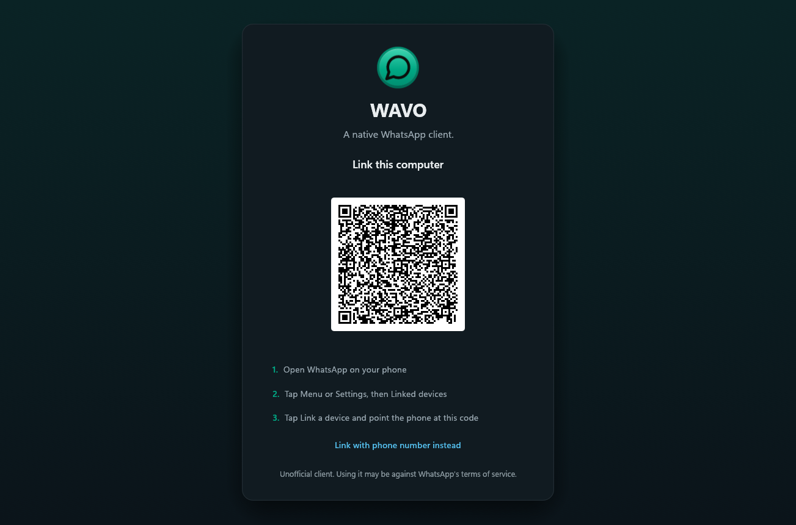

# WAVO

**WhatsApp, native and fast.** WAVO is a WhatsApp client written in Rust with
[egui](https://github.com/emilk/egui), using
[whatsapp-rust](https://github.com/oxidezap/whatsapp-rust) for the WhatsApp Web
protocol. It runs on Linux, macOS, and Windows, links to your phone as a
companion device, and has no browser engine. In our Linux test it opens in
under a second and idles at about 200 MB of RAM, against 1.13 GB for WhatsApp
Web and its Chromium processes.

Want Spotify just as fast and native? [Spotifast](https://spotifast.rocks) is
WAVO's sibling, built on the same
[fastframe](https://github.com/crmne/fastframe) foundation.

https://github.com/user-attachments/assets/2bf86b54-45fc-4add-8de7-c426c3cdad9b

<picture>
  <source media="(prefers-color-scheme: light)" srcset="docs/screenshot-light.png">
  
</picture>

<picture>
  <source media="(prefers-color-scheme: light)" srcset="docs/screenshot-group-light.png">
  
</picture>

<picture>
  <source media="(prefers-color-scheme: light)" srcset="docs/screenshot-link-light.png">
  
</picture>

## Features

- **Linking and profiles.** Scan a QR code, or link with your phone number and
  a pairing code. Recent history is copied to this computer once. Several
  numbers can stay linked in one window: click your own picture at the top of
  the chat list to switch or add one. Each profile has its own keys, archive,
  media, and settings, and can be protected with a password shown at start.

- **Chats.** Pin (up to three), mute, archive, mark as unread, add to
  favorites, filter by unread, private, favorites, or groups, and leave groups
  and channels from the right-click menu. Search across chats, saved messages,
  and contacts; Ctrl+F in a chat searches inside it, with a day filter.
  Typing indicators, chat previews on hover, drafts, and accents-agnostic
  name search.

- **Conversations.** Reply, react, edit, forward, delete, and poll. Multi-select
  messages with Ctrl-click or drag, then forward them as a batch. Voice messages
  play, seek, and record; playback auto-continues through unheard ones.
  Photos, videos (H.264 in place, others in the system player), documents,
  locations, contacts, polls, stickers, and GIFs. WhatsApp formatting, link
  previews, and right-to-left text all render as on the phone.

- **Privacy and locks.** Account privacy settings sync with your phone.
  Screen lock hides WAVO behind a password after an idle time. Locked chats
  hide behind a local code. Read receipts and played receipts follow the
  account toggles; a hidden window never marks anything read.

- **Local.** The message archive is SQLCipher-encrypted, with its key in the
  OS keyring (Secret Service, Keychain, Credential Manager). Attachments,
  avatars, and stickers are ordinary cached files you can delete. The
  interface speaks nine languages and follows the system's light or dark
  theme, including Omarchy palettes; custom JSON themes are welcome. Proxy
  support (`socks5h`, `socks5`, `http`).

## Installing

| Platform | How |
| --- | --- |
| macOS | `brew install --cask abhinavdatta/tap/wavo`, or the `.dmg` from the [releases page](https://github.com/abhinavdatta/wavo/releases) |
| Arch Linux | `yay -S wavo-bin` (built), `wavo` (from source), or `wavo-git` |
| Nix | `nix profile install github:abhinavdatta/wavo` |
| Windows | `wavo-vX.Y.Z-<target>-setup.exe` from the [releases page](https://github.com/abhinavdatta/wavo/releases) (no administrator rights needed), or the `.zip` |
| Linux, other | `.tar.gz` or `.AppImage` from the [releases page](https://github.com/abhinavdatta/wavo/releases) |

Flatpak packaging lives in `packaging/flatpak/`; publication to Flathub is
pending.

WAVO needs OpenGL 2.1 or newer. On Windows, install the driver from the maker
of the graphics chip if the default falls short; WAVO will say so instead of
starting on an unusable driver.

## Building from source

You need Rust (the pinned version from `rust-toolchain.toml`), a C/C++
toolchain, CMake, Perl, and on Linux the GUI development packages:

```sh
# Debian and Ubuntu
sudo apt install libxkbcommon-dev libwayland-dev libgl1-mesa-dev libasound2-dev cmake perl
# Arch
sudo pacman -S libxkbcommon wayland mesa alsa-lib cmake perl
```

```sh
cargo install --path .
wavo
```

With Nix, `nix develop` gets you the toolchain and dependencies;
`nix run .#wavo` builds and runs.

An optional extra keeps the archive key out of reach of your shell history.
Backup note: only `archive.db` and its journals are encrypted; session keys,
media, and settings are plain files, so use full-disk encryption alongside.

## Files

| What | Linux | Notes |
| --- | --- | --- |
| Settings | `~/.config/wavo/settings.json` | JSON, safe to edit |
| Account list | `~/.config/wavo/accounts.json` | Which numbers are linked and which shows |
| Device keys | `~/.local/state/wavo/accounts/<id>/session.db` | Deleting it unlinks that number |
| Messages | `~/.local/state/wavo/accounts/<id>/archive.db` | SQLCipher-encrypted SQLite, key in the OS keyring |
| Attachments, avatars | `~/.cache/wavo/accounts/<id>/` | Safe to delete |
| Stickers | `~/.local/state/wavo/accounts/<id>/stickers/` | Plain WebP files |
| Log | `~/.local/state/wavo/wavo.log` | `--verbose` for more |

macOS and Windows use the same layout under the directories the `directories`
crate picks. A setup from an older version (FastsApp, fastwhatsapp) moves over
on first start.

## Developing

```sh
cargo run --features demo -- --demo            # sample chats, no connection
cargo run --features demo -- --demo-shot shot.png --demo-page chat,light
cargo test --all-features                      # includes a headless layout of every screen
cargo clippy --all-targets --all-features -- -D warnings
```

`AGENTS.md` describes the architecture and the rules for changes.

## Disclaimer

WAVO is an unofficial client and is not affiliated with WhatsApp or Meta.
Using an unofficial client may be against WhatsApp's terms of service and
could get an account suspended. Use it at your own risk.

## License

MIT. Inter and Noto Color Emoji are under the SIL Open Font License; the icons
and the chat wallpaper doodles are from [Lucide](https://lucide.dev) (ISC).
The notification sounds are [Pidgin](https://pidgin.im)'s, under the GPL-2.0
(see `assets/sounds/`).
